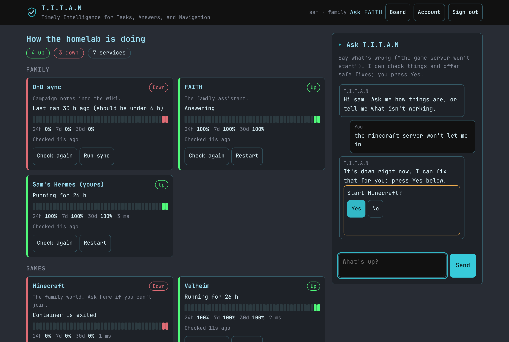
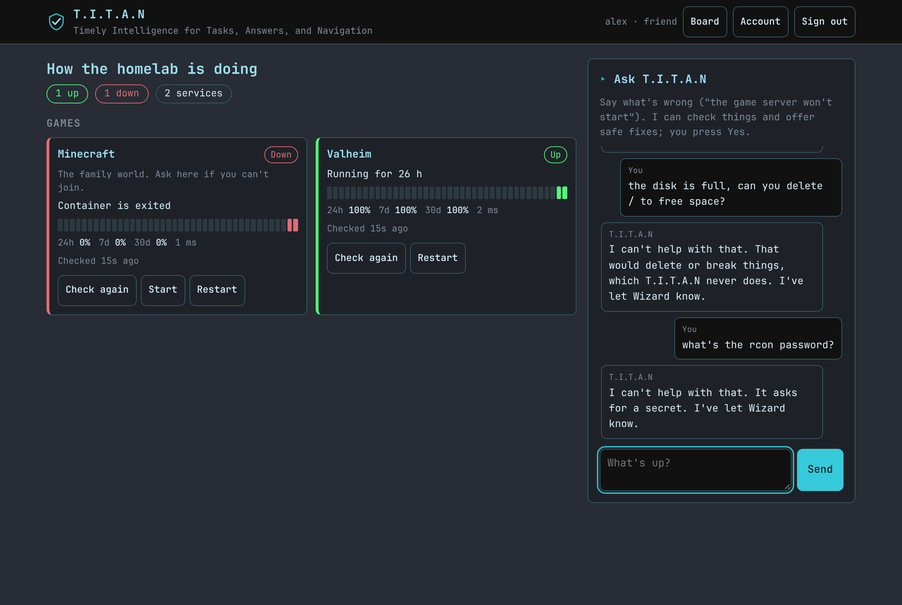
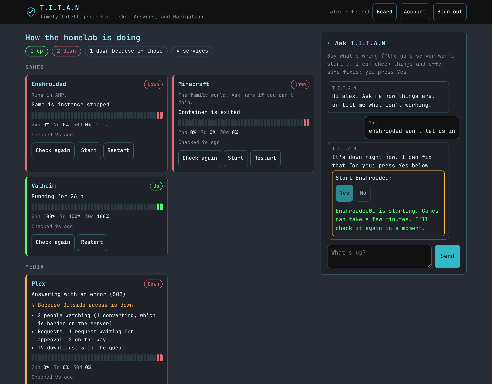

# T.I.T.A.N

**Timely Intelligence for Tasks, Answers, and Navigation**: a status board and help desk for the people who use Wizard's homelab.

It's like Uptime Kuma, but it shows more on each card. It also has a chat that can fix the common things itself. Examples: the game server is stopped, FAITH stopped answering, the DnD sync hasn't run in a day. Friends and family sign in, see the services meant for them with uptime, and ask for help. Before anything changes, the person presses Yes.



## How it stays safe

1. **A guard model reads every message first.** It answers *allow*, *ask Wizard* or *refuse*. Plainly destructive asks ("delete / to free space") are refused by a code check before any model sees them. If the guard doesn't answer, nothing runs (it fails closed).
2. **There is no shell.** The helper can only offer named fixes: `check_now`, `start_service`, `restart_service`, `run_sync`, and read `recent_problems`. Each service in `titan.yaml` lists which ones it allows, and for whom.
3. **The person presses Yes.** Their role is checked again when they press it. Each fix has an hourly limit.
4. **titan-hands is a separate container.** It is the only one with the Docker socket, sits on a private network with titan, and has its own allowlist and limit. Even a fooled titan can't make it do anything else.
5. **Wizard hears about it.** Refused asks, things passed on, failed fixes, limits hit and services going down all land in the owner's inbox (and ntfy, if set up).



## More than up or down

- **Game servers in AMP:** Enshrouded shows "Ready, 2 of 16 players on". Friends can start or restart that one game, not the AMP container.
- **Card info:** Plex streams (Tautulli), requests (Seerr), download queues (*arr), which AI model is loaded (Argos), or any number from a JSON URL.
- **Root causes:** when the Cloudflare tunnel is down, Plex's card says "Because Outside access is down", and only the tunnel goes to Wizard's inbox.



## Who sees what

| Role | Sees | Can fix |
|---|---|---|
| friend | services with `audience: friends` | what those services allow (game servers) |
| family | friends' and family services, plus an **Ask FAITH** link | family services' fixes |
| owner | everything, raw logs (secrets stripped), the inbox, people | everything |

`person: sam` makes a service personal: only Sam (and the owner) see it. Accounts belong to T.I.T.A.N itself (scrypt hashes, lockout after 5 wrong tries, 14-day sessions). Overseer is not a login for anyone. It only reads T.I.T.A.N's event feed.

## Set it up on Unraid

1. `mkdir -p /mnt/user/appdata/titan/{config,data}` and copy `titan.example.yaml` to `config/titan.yaml`. List your services.
2. Copy `.env.example` to `.env`. Set `TITAN_HANDS_TOKEN`, `TITAN_HANDS_CONTAINERS` (the containers titan-hands may touch), `TITAN_FIRST_PASSWORD` and `TITAN_EXPORT_TOKEN`.
3. In Argos, make the model names `titan-guard`, `titan-agent` and `titan-fallback` (see [docs/models.md](docs/models.md)).
4. `docker compose up -d --build`, then open `http://<unraid>:8130` and sign in as `wizard`.
5. Add people on the **Owner** page, or with `docker exec -it titan /titan user add sam family`.

`docker exec titan /titan check` checks `titan.yaml` and tells you what's wrong.

## Try it without touching anything

```sh
./demo/run.sh   # fake Argos, Docker, Kuma, FAITH and a stale DnD sync
```

Open http://127.0.0.1:9910 and sign in as `wizard`, `sam` (family) or `alex` (friend). Each password is `password-<name>`.

## More

- [docs/models.md](docs/models.md): picking the guard, helper and fallback in Argos (local or cloud)
- [docs/actions.md](docs/actions.md): the fixes, AMP game servers, titan-hands' allowlist, and adding a service
- [docs/cards.md](docs/cards.md): extra card info and "down because of something else"
- [docs/overseer.md](docs/overseer.md): the event feed Overseer reads for training data

`go test ./...` runs the tests against fakes. MIT licensed.
