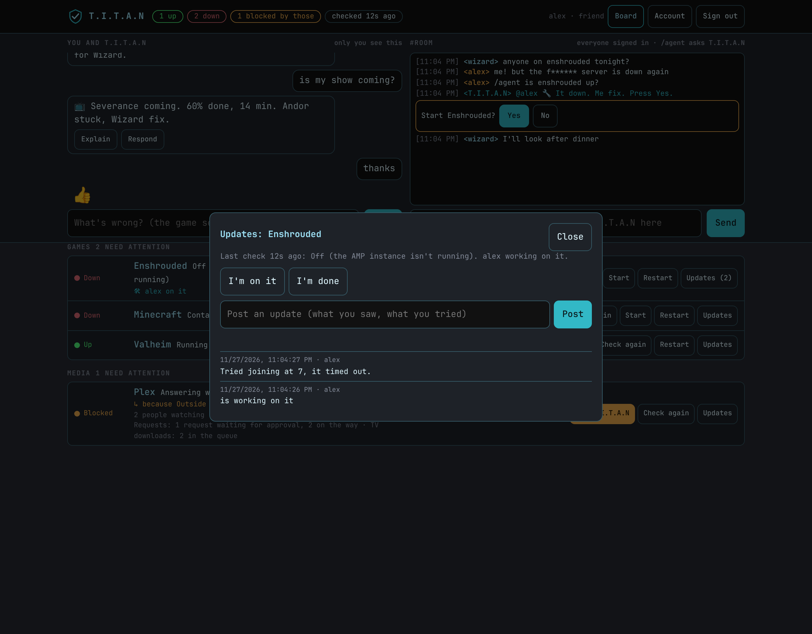

# The page: chat, room, list, updates

The board is one page, top to bottom:

1. **Header:** how many services are up, down or blocked by another one, and when they were last checked.
2. **Chat, the top third.** On the left is your own chat with T.I.T.A.N. On the right is `#room`, which everyone signed in shares. On a phone they are two tabs.
3. **The list,** grouped by `group:` with the broken ones first. A row has its status, detail, card info, the last 40 checks, 24 h uptime, and buttons.

## Your chat

T.I.T.A.N talks like a caveman by default: "🔴 Minecraft sleep. Me start it? Press Yes." Under each answer:

- **Explain** asks for the long version in full sentences. It reuses your last answer and sends nothing new, so it skips the guard.
- **Respond** puts the cursor back in the box.

For "thanks" or "ok" it answers with one emoji. While it works, you see 👀 🔎 🤔 🔧.

Put `style: plain` in `titan.yaml` for full sentences everywhere.

A down row has an **Ask T.I.T.A.N** button. It sends "Minecraft is down. Can you check on it?" to your chat.

## The room

`#room` works like an old IRC channel: `[23:04] <alex> anyone on tonight?`. Anyone signed in can read and talk.

- **Swearing and slurs are masked** before a line is saved: "the f****** server". The list catches l33t spellings (sh1t), stretched letters (fuuuck) and spaced letters (f.u.c.k). Words that hide inside innocent ones (class, cocktail, Scunthorpe) are left alone. Add your own words with `room: {words: [...]}`.
- **No list catches everything.** The owner sees a **remove** button on every line, and the line shows "(removed by Wizard)".
- **Flooding is slowed:** 8 lines per 30 seconds per person.
- **`/titan <message>`** (the old `/agent` still works) asks T.I.T.A.N in the room, and the answer is posted there as `@alex …`. Everyone reads it, so it only knows what friends can see, whatever your role. It leaves out personal services, even yours, and keeps its own history, apart from your private chat. A fix it offers shows its Yes only to you, and only your Yes runs it. For family things, ask in your own chat.
- Room talk is **not** sent to Overseer. `/titan` asks are logged like any chat, under a pseudonym with `"room": true`.
- Lines are kept for `keep_days`. Turn the room off with `room: {off: true}`.

```yaml
room:
  words: [grobble, someword]   # extra words to mask
  # off: true
```

## Updates

Each row has **Updates (n)**, where n is the number of posts in the last 24 h. It opens a popup with:

- the last check,
- who is working on it ("I'm on it" / "I'm done"; this clears after 12 hours, or when the service comes back),
- a timeline.

Anyone who can see the service can post there. T.I.T.A.N posts too: when a service goes down or comes back, when it's down because of another service, and when someone runs a fix through it.



A small dot over the uptime bar marks a check where something was posted. Hover it, tap it or tab to it to read what was posted then. (Phones hide the bar; use Updates there.)

## People (owner page)

- **Add** someone with no password and they get `changeme`. At their first sign-in they must pick their own before anything else works.
- **Reset → Password** sets `changeme` again and signs them out everywhere. **Reset → Name + password** also makes them pick a new name. A reset works for one day; after that, `changeme` stops working and you reset again. Until they sign in, anyone who knows their name and that a reset happened could, so tell them soon.
- **Rename** moves the account and its posts, room lines and fixes to the new name. They sign in again with it. Personal services (`person:` in titan.yaml) name the account, so change those by hand.
- **Runs** hands someone services to run, such as your brother on Enshrouded. They see those services and get every fix listed on them, the quiet button, Confirmed up and Recent problems, as you would. Nothing else changes: no other services, no owner page, and none of it in the room. Personal services and found containers can't be handed out. The fixes are still only the named actions in titan.yaml and titan-hands' allowlist; file fixes come with the backed-up tools work.
